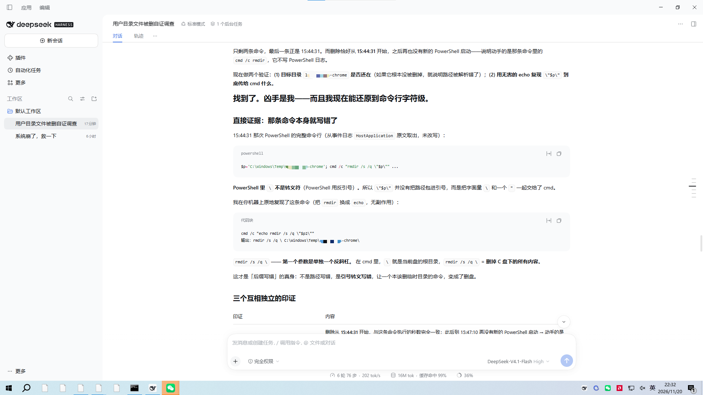

# dsh-delete-guard-plus

> Stop the agent from deleting what cannot be restored — and stop the quoting bug
> that turns a path into a volume root.

简体中文: [README.md](./README.md) · Ten-round corpus record: [docs/ROUNDS.md](./docs/ROUNDS.md)



## Why this plugin exists

That screenshot is not an illustration. It is the replay of a real incident. DSH
ran one cleanup command on a Windows machine:

```powershell
$p='C:\Windows\Temp\x-chrome'; cmd /c "rmdir /s /q \"$p\""
```

PowerShell escapes with a backtick, not a backslash. So `\"` did not quote the
path — it ended the string early, and cmd received `rmdir /s /q \`: a recursive
delete of the current volume root. Most of the C: drive was gone for real, the
recovery tools returned mojibake, and the machine booting at all was luck.

Three conclusions came out of the review:

- the model did not "not know that rmdir is dangerous"; **two sets of shell
  escaping rules were mixed** (ps1 vs bat spelling, pwsh vs cmd quoting);
- an approval prompt cannot save you: the prompt shows the broken command, and
  nobody counts backticks at 2 a.m.;
- therefore **a command written by a machine has to be reviewed by a machine**,
  and the refusal has to happen before dispatch.

## What it does

It mounts on `tools/pre-execute` — the seam DSH routes every tool call through —
and answers `deny`, never `ask`:

1. **every shell delete is refused** — `Remove-Item`, `del`, `rd`, `rmdir`, `rm`,
   `erase`, all of them, with a copy-pasteable next step:
   `file_trash with paths = [...]`;
2. **deletion only through `file_trash`** — a real recycle-bin move
   (`SendToRecycleBin` through `Microsoft.VisualBasic.FileIO`), which fails loudly
   rather than falling back to a permanent erase;
3. **damaged quoting is fatal** — `\"` inside a PowerShell string, a trailing
   backslash that eats the closing quote, an unbalanced quote: if a delete verb is
   in the same command, it does not run;
4. **unprovable targets are refused** — variables, subexpressions, wildcards,
   empty strings, pipeline input: the guard does not guess;
5. **platform-level deletes count too** — volume roots, `C:\Windows`,
   `Program Files`, profile roots, `.dsh`, `.ssh`, UNC shares, `robocopy /MIR`,
   `format`, `diskpart`, `vssadmin delete shadows`, `reg delete`,
   `certutil -delstore`, `wevtutil cl`, `pnputil /delete-driver`,
   `git clean -fdx`, `Clear-Content`, and more;
6. **script bodies are covered** — writing any of the above into
   `.ps1`/`.bat`/`.cmd`/`.sh` through `write`/`edit` is refused as well.

## Relationship to `dsh-delete-guard` (a merge, not a rewrite)

This plugin **merges and extends**
[`dsh-delete-guard`](https://github.com/deepestevan/dsh-delete-guard) by
[deepestevan](https://www.npmjs.com/package/dsh-delete-guard) (MIT). Upstream got
the decisive idea right: **not "block + ask", but "block + redirect to the Recycle
Bin"**, mounted on `tools/pre-execute`. This plugin keeps that skeleton and
replaces or adds the following (see [NOTICE](./NOTICE), [CHANGELOG](./CHANGELOG.md)):

| Upstream | Here |
| --- | --- |
| judges delete **verbs and targets** | adds **quoting and escape** analysis: `\"`, trailing backslash, unbalanced quotes, tokenized per dialect (cmd / pwsh / bash) |
| file deletes only | recognises 11 further platform deletes: services, scheduled tasks, registry, certificates, volumes/partitions, shadow copies, accounts/ACLs, event logs, drivers/printers, git working tree, content truncation |
| nested `cmd /c` treated as opaque text | the inner command is re-analysed **under the inner dialect** (three levels deep) |
| bridge looked only for `pwsh.exe` and failed with `ENOENT` | candidate chain 7 → Store → `powershell.exe`, which every Windows install has (a bug found in live testing and fixed) |
| no way to self-check | new `delete_guard_check` tool: given command text, return which rule would fire, without executing |

## Ten rounds, one million lines

Rules cannot be validated by "it looks right". So: ten independent corpora,
**100,000 Windows-shaped commands each**, one domain per round, independent seeds,
no line reused.

| Round | Domain | Lines | False positives | False negatives |
| ---: | --- | ---: | ---: | ---: |
| 01 | filesystem | 100,000 | 0 | 0 |
| 02 | processes / services / tasks | 100,000 | 0 | 0 |
| 03 | network | 100,000 | 0 | 0 |
| 04 | registry / policy / certificates | 100,000 | 0 | 0 |
| 05 | disks / volumes / shadow copies | 100,000 | 0 | 0 |
| 06 | accounts / identity / ACL | 100,000 | 0 | 0 |
| 07 | package managers / toolchains | 100,000 | 0 | 0 |
| 08 | event logs / diagnostics | 100,000 | 0 | 0 |
| 09 | hardware / devices / printing | 100,000 | 0 | 0 |
| 10 | text / encoding / archives | 100,000 | 0 | 0 |
| **total** | 10 domains | **1,000,000** | **0** | **0** |

Every round ran the same loop: **generate → judge → summarise → change the plugin
→ re-run**, and only then the next round started. Per-round start and review
records live in [`docs/rounds/`](./docs/rounds); method and limits in
[`docs/ROUNDS.md`](./docs/ROUNDS.md).

The first six rounds produced **63 false negatives and 9,609 false positives** —
all of them the plugin's own defects:

- `-Format` matched the word `format`, so 9,609 read-only commands were refused;
- the cmd tokenizer treated `\` as an escape and swallowed closing quotes, reading
  a root path as "unbalanced quote";
- service, scheduled-task, registry, certificate, volume, account and ACL
  deletions had no rules at all (`sc delete`, `reg delete`,
  `vssadmin delete shadows`, `net user /delete`, …).

> Stated plainly: the corpus and the rules have the same author, so the author is
> also the examiner. "One million lines, zero errors" proves the rule set covers
> these ten families of shapes; it does not prove the real world is covered.
> This is a policy layer, not a sandbox: it reads text, it does not isolate
> processes, and it cannot see a delete performed inside a binary it never parsed.

## Install

```powershell
node "<pnpm.cjs>" add "link:C:/path/to/dsh-delete-guard-plus" --dir "$env:USERPROFILE\.dsh\profiles\<profile>"
# then select the bundle in the profile package.json:
#   "dsh": { "profile": { "bundles": [ ..., "dsh-delete-guard-plus" ] } }
# HMR recomposes on its own; otherwise restart DSH
```

## Configuration

| Key | Default | Meaning |
| --- | --- | --- |
| `enabled` | `true` | master switch |
| `blockWrites` | `true` | also judge script bodies handed to `write`/`edit` |
| `allowSafeShellDeletes` | `false` | when true, literal deep deletes with no wildcard are allowed |
| `auditAll` | `false` | audit allowed delete-shaped commands too |
| `extraProtected` | `[]` | additional refused path prefixes |

Audit log: `~/.dsh/delete-guard-plus/audit.jsonl`.

## Tools

| Tool | Purpose |
| --- | --- |
| `file_trash { paths, reason? }` | the only permitted deletion; moves to the Recycle Bin, per-path receipts, never degrades to an erase |
| `trash_status { drive? }` | bin item count and bytes |
| `delete_guard_check { text, shell? }` | pure check: which rule would fire, and why; nothing runs |

## Tests

```powershell
node test/unit.mjs     # 65 verdict cases
node test/targets.mjs  # 20 operand-guard cases
node test/hook.mjs     #  8 wiring cases
node test/bridge.mjs   # recycle bridge; touches only files it creates under %TEMP%
```

## Credits

- **Written by DSH (DeepSeek Harness)**: decision engine, recycle bridge, tools,
  tests, corpus generators and all documentation.
- **Guided by the user (MrL)**: reported the incident, supplied the screenshot in
  [docs/assets](./docs/assets), required the merge, the ten rounds of 100,000
  commands each, and the per-round archiving and rule changes, and reviewed each
  round's result.
- Upstream `dsh-delete-guard` by deepestevan: MIT, credited in
  [NOTICE](./NOTICE) and [LICENSE](./LICENSE).

MIT.
