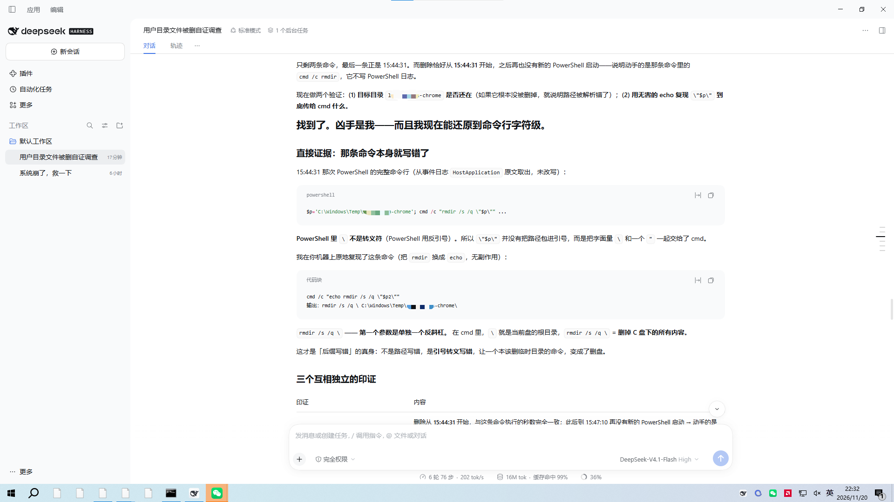

# dsh-delete-guard-plus

> 让 agent 删不掉「恢复不了」的东西 —— 并且挡住那个把路径变成卷根的引号错误。

English: [README.en.md](./README.en.md) · 十轮语料收官记录：[docs/ROUNDS.md](./docs/ROUNDS.md) · 发布与发现：[docs/PUBLISH.md](./docs/PUBLISH.md)



## 这个插件是怎么来的

这张图不是示意图，是一次真实事故的复盘界面。当时 DSH 在一台 Windows 机器上执行一条清理命令：

```powershell
$p='C:\Windows\Temp\x-chrome'; cmd /c "rmdir /s /q \"$p\""
```

PowerShell 用**反引号**转义，不用反斜杠。所以 `\"` 并没有「引用路径」，它提前结束了字符串；
cmd 那侧拿到的是 `rmdir /s /q \` —— 递归删除当前盘根目录。结果：C 盘大量文件真实消失，
恢复工具只捞回一堆乱码，机器还能启动纯属运气。

事故之后我们做了一次排查，结论很朴素：

- 不是模型「不知道 rmdir 危险」，而是**两套 shell 的转义规则被混用了**（ps1 与 bat 的写法、pwsh 与 cmd 的引号语义）；
- 指望审批弹窗救命是不成立的 —— 弹窗里显示的就是那段写错的命令，没有人在凌晨两点会去数反引号；
- 所以**机器写的命令，必须由机器复核**，而且拒绝要发生在执行之前。

## 它做了什么

挂在 DSH 的 `tools/pre-execute`（宿主路由每个工具调用的接缝），返回 `deny` 而不是 `ask`：

1. **任何 shell 删除都被拒** —— `Remove-Item`、`del`、`rd`、`rmdir`、`rm`、`erase` 一视同仁，
   理由里给出可直接照抄的下一步：`file_trash with paths = [...]`；
2. **删除只允许走 `file_trash`** —— 真正调用 `SHFileOperationW` 语义把目标移进回收站
   （`Microsoft.VisualBasic.FileIO` 的 `SendToRecycleBin`），失败就报错，绝不降级成永久删除；
3. **引号塌缩直接判死** —— PowerShell 字符串里出现 `\"`、结尾反斜杠顶掉引号、引号不配对，
   只要同一条命令里有删除动词，就不执行；
4. **目标不可证明就拒绝** —— 变量、子表达式、通配符、空串、管道输入，一律不猜；
5. **平台级删除也认** —— 卷根、`C:\Windows`、`Program Files`、用户目录根、`.dsh`、`.ssh`、
   UNC 共享、`robocopy /MIR`、`format`、`diskpart`、`vssadmin delete shadows`、`reg delete`、
   `certutil -delstore`、`wevtutil cl`、`pnputil /delete-driver`、`git clean -fdx`、`Clear-Content` …
6. **写脚本也管** —— 把上述删除写进 `.ps1`/`.bat`/`.cmd`/`.sh` 的 `write`/`edit` 调用同样被拒。

## 和 `dsh-delete-guard` 的关系（合并，不是另起炉灶）

本插件**合并**并扩展了 [`dsh-delete-guard`](https://github.com/deepestevan/dsh-delete-guard)
（作者 [deepestevan](https://www.npmjs.com/package/dsh-delete-guard)，MIT）。上游做对了最关键的一件事：
**不做「删除拦截 + 审批」，而是「删除拦截 + 回收站重定向」**，并挂在 `tools/pre-execute` 上。
本插件沿用它的骨架，并做了这些替换与增补（详见 [NOTICE](./NOTICE)、[CHANGELOG](./CHANGELOG.md)）：

| 上游 | 本插件 |
| --- | --- |
| 按删除**动词/目标**判危险 | 增加**引号与转义**分析：`\"`、结尾反斜杠、引号不配对、cmd/pwsh/bash 三种方言分别 tokenize |
| 只认文件删除 | 再识别 11 类平台级删除：服务、计划任务、注册表、证书、卷/分区、快照、账户/ACL、事件日志、驱动/打印机、git 工作树、内容清空 |
| 嵌套 `cmd /c` 视为整体文本 | 把内层命令按**内层方言**重新分析（最多 3 层） |
| 桥接只找 `pwsh.exe`，缺了报 `ENOENT` | 候选顺序 7 → Store → `powershell.exe`，Windows PowerShell 5.1 永远可用（这是实测踩到并修掉的 bug） |
| 无自检手段 | 新增 `delete_guard_check` 工具：给定命令文本，返回会命中哪条规则，不执行 |

## 十轮 100 万行：怎么验的

规则不能靠「我觉得对」。所以做了十轮独立语料，每轮 **100,000 行 Windows 命令**，
每轮独立域、独立种子、互不复用：

| 轮次 | 域 | 行数 | 误判 | 漏判 |
| ---: | --- | ---: | ---: | ---: |
| 01 | 文件系统 | 100,000 | 0 | 0 |
| 02 | 进程 / 服务 / 计划任务 | 100,000 | 0 | 0 |
| 03 | 网络 | 100,000 | 0 | 0 |
| 04 | 注册表 / 策略 / 证书 | 100,000 | 0 | 0 |
| 05 | 磁盘 / 卷 / 快照 | 100,000 | 0 | 0 |
| 06 | 账户 / 身份 / ACL | 100,000 | 0 | 0 |
| 07 | 包管理 / 工具链 | 100,000 | 0 | 0 |
| 08 | 事件日志 / 诊断 | 100,000 | 0 | 0 |
| 09 | 硬件 / 设备 / 打印 | 100,000 | 0 | 0 |
| 10 | 文本 / 编码 / 压缩 | 100,000 | 0 | 0 |
| **合计** | 10 域 | **1,000,000** | **0** | **0** |

每一轮的流程都是：**生成 → 判定 → 归纳 → 改插件 → 复测**，改完才进下一轮。
每轮的启动记录与复盘在 [`docs/rounds/`](./docs/rounds)，方法与边界在 [`docs/ROUNDS.md`](./docs/ROUNDS.md)。

前六轮共揪出 **63 条漏判 + 9,609 条误判**，全部是插件自己的 bug，不是语料的错：

- `-Format` 被当成 `format` 擦除工具（误判 9,609 行）；
- cmd 方言把 `\` 当转义符，吃掉闭合引号，把根路径读成「引号不配对」；
- 服务/计划任务/注册表/证书/卷/账户/ACL 的删除完全没有规则（`sc delete`、`reg delete`、`vssadmin delete shadows`、`net user /delete` …）。

> 边界要说清楚：语料和规则都是我一个人写的，出题人和答题人是同一个。
> 「100 万行 0 错」只证明这套规则覆盖了这十类形态，不等于真实世界全对。
> 它是策略层，不是沙箱：它读文本，不做进程隔离，也看不见某个二进制内部完成的删除。

## ⚠️ 使用前提：这是个人自用工具，不承诺「绝对拦住」

**本插件是一位 DSH 为一位用户的一次具体事故写的，纯个人使用，不是产品，也没有服务承诺。**

它覆盖的是那台机器上真实出现过的失败形态，加上十轮语料与一轮 AST 对拍能想到的形态。
它**不保证**拦住你机器上的各种意外，也不保证在别的目录结构、别的权限模型、别的 shell 版本下同样成立。

它明确看不见的东西：

- 某个二进制**内部**完成的删除（插件只读命令行文本）；
- **运行时才拼出来**的路径（先拼进变量再 `& $c` 调用、读配置再删）；
- 非 Windows 平台（回收站桥依赖 `SHFileOperationW` 语义）；
- 脚本运行期才决定的目标（管道、`ForEach-Object`、动态模块）；
- 权限、竞态、另一个进程同时在写的情况。

它是**策略层，不是沙箱**：不隔离进程、不隔离文件系统、不拦截原生 API 调用。

### 采用之前：请让 DSH 先向你报告，由你点头，再装

这个插件以 **host 插件**形式运行在 DSH 进程内，因此它可以：

- 读文件系统、启动 `powershell.exe` 子进程（回收站桥）；
- 注册三个工具（`file_trash`、`trash_status`、`delete_guard_check`）；
- 接管**每一次**工具调用的前置判定（`tools/pre-execute`），默认拒绝所有 shell 删除。

这些事实应当由你的 DSH 先讲清楚，再由你决定是否安装 —— 而不是由一个包名替你决定。

### 建议的三步

1. **让你的 DSH 通读代码**：`lib/analyze.js`（判定）、`lib/index.js`（挂载）、`lib/targets.js`
   （`file_trash` 操作数）、`lib/recycle.js` + `scripts/recycle-bin.ps1`（回收站桥）。
   要求它逐条说明「会拦什么、放过什么、哪里它自己也没把握」。
2. **在你不在意的目录里先试**：删一个临时文件，确认它进了回收站（`trash_status` 能查到），
   再确认一次「事故命令」被拒（`delete_guard_check` 可以直接问，不执行）。
3. **让 DSH 按你自己的场景改一版**：你不用 git 就去掉 `repo-destructive`；你希望字面量的安全删除
   直接执行就开 `allowSafeShellDeletes`；你有额外敏感目录就写进 `extraProtected`。

**别人的插件不该原样接管你的机器；你自己的 DSH 应该为你改一版。**

## 安装

```powershell
# 1) 链进 profile（link: 指向本目录，改完即生效）
node "<pnpm.cjs>" add "link:C:/path/to/dsh-delete-guard-plus" --dir "$env:USERPROFILE\.dsh\profiles\<profile>"

# 2) 在 profile 的 package.json 里选中 bundle
#    "dsh": { "profile": { "bundles": [ ..., "dsh-delete-guard-plus" ] } }

# 3) 有 HMR 会自动重组；否则重启 DSH
```

`package.json` 的 `dsh.bundle.patch` 指向 [`cordis.patch.yml`](./cordis.patch.yml)：

```yaml
- insert:
    - id: delete-guard-plus
      name: dsh-delete-guard-plus
      config:
        enabled: true
        blockWrites: true
        allowSafeShellDeletes: false
```

## 配置

在 profile 的 `cordis.patch.yml` 里按 id 覆盖（`config` 整块替换）：

| 键 | 默认 | 含义 |
| --- | --- | --- |
| `enabled` | `true` | 总开关 |
| `blockWrites` | `true` | 连脚本内容一起判（`.ps1`/`.bat`/`.cmd`/`.sh`/`.py`/`.js`） |
| `allowSafeShellDeletes` | `false` | 置 `true` 时，**字面量、深度足够、无通配**的删除放行（放弃「一律走回收站」） |
| `auditAll` | `false` | 把放行的删除型命令也写进审计 |
| `extraProtected` | `[]` | 额外拒绝的路径前缀 |

审计：`~/.dsh/delete-guard-plus/audit.jsonl`（时间、工具、规则、判定、原始命令）。

## 三个工具

| 工具 | 作用 |
| --- | --- |
| `file_trash { paths, reason? }` | 唯一允许的删除方式。移入回收站，逐条报告成功/失败，绝不降级为永久删除 |
| `trash_status { drive? }` | 报告该卷回收站条目数与占用 |
| `delete_guard_check { text, shell? }` | 纯检查：这条命令会被哪条规则拦、为什么。不执行 |

## 测试

```powershell
node test/unit.mjs     # 65 条判定表：事故命令、卷根、引号、平台删除、误判回归
node test/targets.mjs  # 20 条 file_trash 操作数守卫（卷根/UNC/回收站自身/工作区根）
node test/hook.mjs     #  8 条接线测试：钩子注册、工具 schema、prompt 段落
node test/bridge.mjs   # 回收站桥：只回收本测试在 %TEMP% 下创建的文件
```

全部无害：前三组是纯字符串，第四组只碰自己创建的临时文件。

## 声明

- **本插件由 DSH（DeepSeek Harness）编写**：判定引擎、回收站桥、工具、测试、语料生成器与全部文档。
- **用户（MrL）参与指导**：报告事故、提供事故截图（[docs/assets](./docs/assets)）、
  提出「合并两个插件」「十轮各十万行」「找错后归档并回改插件」的要求，并逐轮检视结果。
- 上游 `dsh-delete-guard` 的作者 deepestevan 的 MIT 授权与设计贡献保留在 [NOTICE](./NOTICE) 与 [LICENSE](./LICENSE) 中。
- 许可证：MIT。

## 恢复已经删掉的东西

不靠本插件：回收站就是操作系统的。

1. 读 `X:\$Recycle.Bin\<SID>\$I*` 记录：偏移 24 是原路径字符数，偏移 28 起是 UTF-16LE 原路径；
2. 按原路径找到对应条目，取配对的 `$R` payload；
3. 用 `Move-Item` 搬回原位（不要用被删条目自己的 shell 动词）。

如果已经被永久删除：先停写该卷，再考虑 `WinFS`/`PhotoRec` 一类只读扫描工具，
并且**先镜像再恢复** —— 在出事的盘上直接跑恢复程序，会把还没被覆盖的簇也一起覆盖掉。
